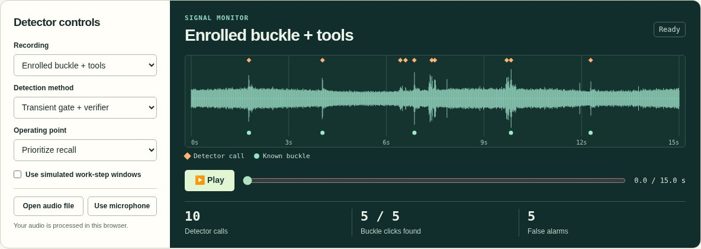

# Latch Listen

An interactive CPU-only detector for short mechanical clicks. It listens to one microphone, timestamps candidate impulses and scores which ones sound like an enrolled buckle. The intended use case is an assembly step hidden from a camera.

**[Open the live demo](https://lch8.github.io/demos/latch-listen/)** · [Detector](detector.mjs) · [PyTorch training](lab/station_head.py) · [Audio credits](CREDITS.md)

[](https://lch8.github.io/demos/latch-listen/)

### Try it in one minute

1. Play **Enrolled buckle + tools**. Under **Event inspection**, audition the labeled buckle and the ratchet. Click any detector call to hear what triggered it.
2. Switch between **Transient gate only** and **Transient gate + verifier** on exactly the same audio. Enable **simulated work-step windows** and watch which calls disappear.
3. Try **Tools only** or **Unseen buckle + tools**. **Open audio file** and **Use microphone** run the station model locally in the browser. The microphone view shows the latest 15 seconds and discards the audio. Only the bundled replays have reference labels.

## Design

A single microphone on an occluded assembly step hears many short, sharp noises. A hammer, a ratchet and a pen button can all cross the same energy threshold as a buckle. The front end therefore proposes events cheaply. A second stage examines the candidate's spectrum and decay.

- **Always-on trigger.** Sample at 16 kHz. Every 5 ms, compare the energy of the first difference with a slowly updated, clipped noise-floor estimate. The stream uses 150 ms of startup adaptation and an 80 ms refractory interval between triggers.
- **Candidate verifier.** Retain 5 ms before the trigger block, that 5 ms block and 40 ms after it. Compute 23 features from six frequency bands, a ten-bin energy envelope and the crest factor. The station head has 16 ReLU units and 401 trainable parameters. The unseen-buckle head is logistic regression. Standardization is folded into the exported weights.
- **Decision clock.** Each call carries an estimated event timestamp and a separate time at which the score became available. The browser, microphone worklet and Node benchmark share the same incremental detector. The visual replay scores the file ahead of playback to make seeking and threshold comparison immediate.
- **Optional process context.** A supplied time window determines when a call counts. The example schedule is generated before audio placement, includes empty steps and sometimes misses a real event. It illustrates how a future vision or IMU system could provide timing cues. The project has no measured vision or IMU input.

### Research behind the design

Cao et al. (2026) studied the same automotive connector problem with a microphone near the operator's hand, a second ambient microphone and a conditioned diffusion model. Glasses alone may lack that near-hand reference. This demo uses the preceding sound from the same channel to estimate the noise floor and spends classifier compute only on short candidate windows. The algorithms and data differ, so the scores below have their own protocol. [Paper](https://doi.org/10.3390/e28040364)

Espinosa, Ponce and Gutiérrez studied automotive electrical-harness clicks and released a labeled feature table. That table enables an independent check on industrial data. Separately, the DCASE 2026 machine-monitoring task explicitly varies environmental noise and recording distance. The unmodified workshop replay below probes transfer to an additional real acoustic environment. [Automotive paper](https://doi.org/10.1016/j.asoc.2021.107465) · [Public dataset](https://doi.org/10.17632/2p4ng7zz3s.1) · [DCASE 2026](https://dcase.community/challenge2026/index)

## Evaluation

The fixtures mix **recorded seat-belt clicks**, recorded tool sounds and a recording of machinery, with added broadband noise. Four local event-to-background levels are used (−3, 3, 9 and 15 dB). The reference time is the anchor of the inserted transient. A chronological one-to-one match allows ±50 ms. Every extra call counts as a false alarm and every unmatched target counts as a miss.

Each profile uses 72 training scenes, 36 development scenes and 60 test scenes, each 15 seconds. The **station** profile enrolls takes 1 and 2 of a published four-take buckle series, calibrates on take 3 and tests on take 4. This approximates commissioning at a station. The **unseen** profile holds out buckle recordists, tool recordings and room recordings across splits. Station test events repeat one source take under varied mixtures. Unseen test events repeat two source takes. These experiments measure robustness to the constructed mixtures. A physical acceptance test would require distinct attempts by operators, glasses-mounted recordings, partial engagements, no-click attempts and independent mechanical confirmation.

Both methods select their sensitive thresholds on development data using a 90% event-recall target. Neither method uses test labels for threshold selection. The stricter setting maximizes development recall subject to at most one development false alarm.

| Station setting, same 15-minute test | Found / present | Recall | False alarms | Precision | False alarms/h |
|---|---:|---:|---:|---:|---:|
| Transient gate only | 176 / 208 | 84.6% | 636 | 21.7% | 2,544 |
| Gate + verifier | 198 / 208 | 95.2% | 444 | 30.8% | 1,776 |
| Verifier + simulated work-step windows | 173 / 208 | 83.2% | 168 | 50.7% | 672 |
| Verifier at strict threshold | 0 / 208 | 0.0% | 1 | 0.0% | 4 |

The station verifier reduced false alarms by **30.2%** against the gate while recovering **22 more events**. The injected tool density is high (typically 7–12 tools per 15 seconds, plus some overlaps). At the strict operating point every station-test buckle was missed. The demo therefore demonstrates the recall/false-alarm trade-off and leaves factory acceptance open.

On the unseen-buckle test, the gate found 178/201 events with 577 false alarms. The verifier found 196/201 with 602 false alarms. The extra recall came with more false calls on the held-out tools. Full per-SNR counts, development scores and timings are included. [Station results](results/station/benchmark.json) · [Unseen results](results/unseen/benchmark.json)

### Continuous workshop recording

A 52 min 17.8 s field recording from a diamond-tool factory contains grinding, hammering, lathing and speech. It was excluded from enrollment and calibration. With all thresholds frozen, the station gate produced **414 calls**, the station verifier **231 calls** (265.0/h), and the strict station verifier **0**. The recording has no intentional buckle insertions or event annotations, so these are alarm activations per hour. It cannot establish a labeled field false-positive rate. [Recording and credit](https://freesound.org/people/ftpaddict/sounds/190637/) · [Full counts, including the unseen profile](results/workshop.json)

### Independent automotive feature-table check

The public automotive release contains 68,768 rows with 213 feature values and a binary class ID. It contains 6,491 repeated feature rows and no conflicting exact duplicates. The audit keeps one copy of each feature vector, uses original-row blocks for train/dev/test and purges 100 rows on each side of both split boundaries. A separate linear classifier used 12,000 training rows and achieved **98.00% balanced accuracy** and **0.9979 ROC AUC** on 11,239 test rows. The CSV has no station/session IDs, raw waveforms or event timestamps. Its numbers apply only to that table classifier. [Script](lab/industrial.py) · [Counts and confusion matrix](results/industrial.json)

## CPU cost

On the measured Linux x86-64 host (AMD EPYC 9V74, Node 24.22.3, Python 3.12), the station fit took **1.97 s** on one CPU thread. Scene generation, streaming feature extraction and fitting together took **4.59 s**. The full train/dev/test run took **8.16 s** after dependencies were installed. The unseen linear fit took **0.01 s**. Benchmarks exclude installation, file I/O from the detector timing, and microphone, browser output and device-driver latency.

The verifier examined 931 candidate windows totaling **5.17%** of station test audio. On matched events the station p95 time from the reference anchor to an available decision was **45.8 ms** on the audio sample clock. The RTF measured for streaming detection alone was **0.000127** on this host. Smart-glasses compute, power draw and end-to-end sensor latency still need measurement.

## Reproduce

From a clone of this repository, enter the demo directory. The browser demo, model weights and test fixtures are included. Python 3.12 and Node 20+ are suitable for the lab. The bundled source excerpts allow the standard experiments to run offline after installation.

```bash
cd public/demos/latch-listen
python -m http.server 8000
# Open http://localhost:8000
```

```bash
python -m venv .venv
. .venv/bin/activate
python -m pip install -r lab/requirements.txt
# Linux CPU wheel for the station model. On macOS, install torch==2.8.0 from PyPI.
python -m pip install torch==2.8.0 --index-url https://download.pytorch.org/whl/cpu
OPENBLAS_NUM_THREADS=1 OMP_NUM_THREADS=1 python lab/evaluate.py --profile station --out /tmp/latch-station
OPENBLAS_NUM_THREADS=1 OMP_NUM_THREADS=1 python lab/evaluate.py --profile unseen --out /tmp/latch-unseen
node --test tests/detector.test.mjs
```

To stream any local recording through the actual detector, pipe 16 kHz mono PCM into the Node reader. Drop `--summary` to get an event stream with candidate and decision timestamps. FFmpeg is also required for `--render-demos`.

```bash
ffmpeg -loglevel error -i audio/mixed.flac -ar 16000 -ac 1 -f s16le - | node lab/monitor.mjs results/station/model.json --summary
```

Download the original `DataSet.csv` from the automotive deposit to reproduce the separate feature-table benchmark. The script verifies its SHA-256 before evaluation.

```bash
OPENBLAS_NUM_THREADS=1 python lab/industrial.py /path/to/DataSet.csv
```
